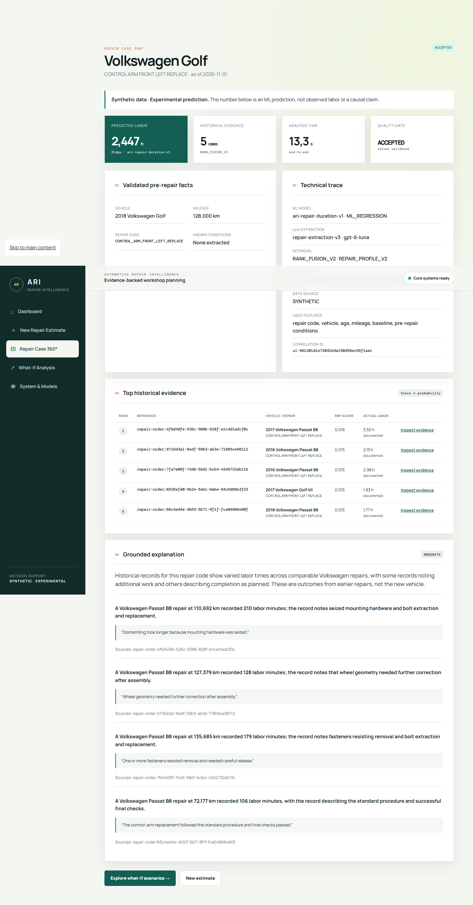
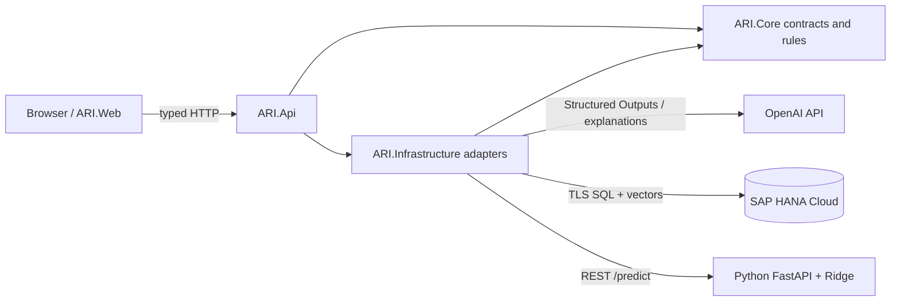
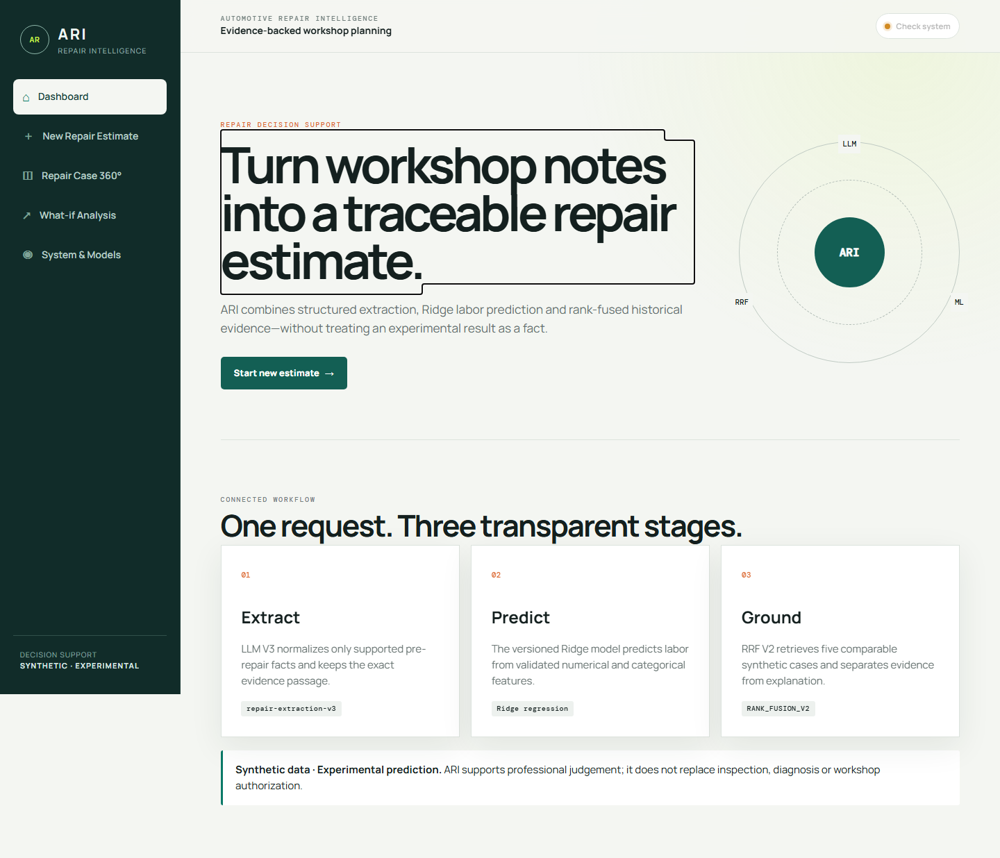
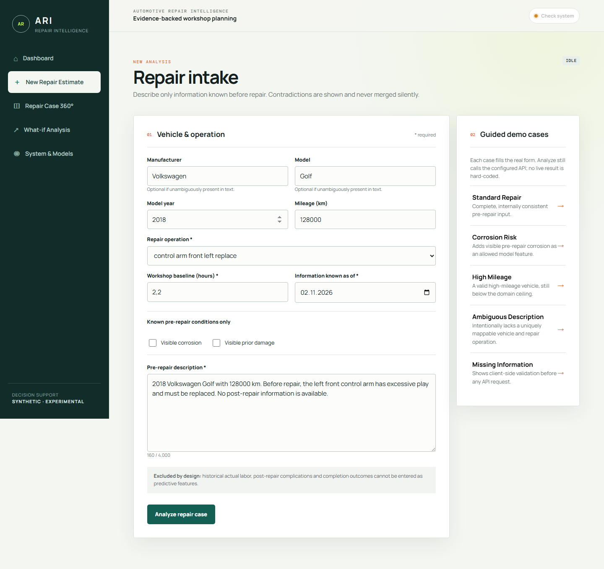
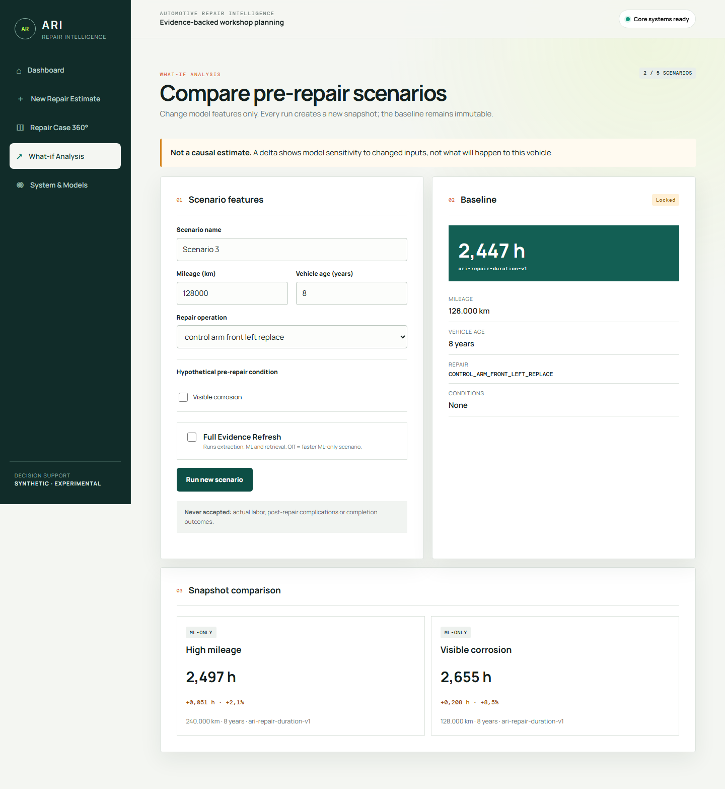

# Automotive Repair Intelligence

> **Showcase candidate:** `ARI-RC1` (`0.1.0-rc.1`) · synthetic-data engineering demonstrator · not a production workshop system

Automotive Repair Intelligence (ARI) is an auditable repair-effort decision-support prototype. It turns a pre-repair workshop description into validated structured facts, predicts labor time with a versioned Ridge model, retrieves comparable synthetic repairs from SAP HANA Cloud, and generates an explanation that is restricted to those retrieved sources. A Blazor UI exposes the full workflow and lets reviewers compare controlled what-if scenarios without overwriting the baseline.



## Key capabilities

- Guided repair intake with temporal-leakage guardrails.
- OpenAI Structured Outputs V3 extraction plus deterministic, evidence-preserving classification.
- Versioned scikit-learn Ridge prediction served by an independent FastAPI process.
- SAP HANA Cloud relational persistence and 1,536-dimensional vector search.
- Structured-first Reciprocal Rank Fusion (RRF V2) and source-grounded explanations.
- Repair Case 360° with status, correlation, model, retrieval, latency, and source metadata.
- Non-destructive what-if comparisons against an immutable baseline.
- Explicit **deterministic fixture** and **live integration** demo modes.

The precise candidate boundary is recorded in the [ARI-RC1 scope and repository audit](docs/release-scope-and-audit.md). Full workshop management, commercial deployment, real customer data, new ML methods, and further LLM/RAG optimization are deliberately outside this candidate.

## Architecture



`ARI.Core` is vendor-neutral. SAP HANA, OpenAI, and Python integration exist only in `ARI.Infrastructure`; `ARI.Api` composes the ports, and `ARI.Web` talks to the API through a typed client. The current component and request-flow diagrams are in [Architecture](docs/architecture.md), and the consolidated decision record is in the [ADR index](docs/adr/README.md).

## Stack

| Layer | Technology | Responsibility |
| --- | --- | --- |
| UI | Blazor Interactive Server, .NET 10 | Guided intake, 360° evidence, what-if comparison |
| API/domain | ASP.NET Core, C# 14, .NET 10 | Orchestration, validation, provider-neutral contracts |
| Persistence/retrieval | SAP HANA Cloud, `REAL_VECTOR(1536)` | Relational history, exact cosine search, RRF candidates |
| Language model | OpenAI Responses API | Structured extraction and grounded explanation |
| ML | Python 3.11+, FastAPI, scikit-learn | Reproducible training and read-only Ridge inference |
| Verification | xUnit, Playwright, pytest/unittest | Unit, contract, integration, browser, and live acceptance |

## How it works

1. The browser sends vehicle, operation, baseline, and pre-repair text to `ARI.Api`.
2. LLM V3 returns schema-constrained facts; application validators reject unsupported or temporally invalid claims.
3. The API calls the versioned Ridge service for the numerical estimate.
4. HANA retrieves compatible historical cases with RRF V2 and a strict `asOfUtc` boundary.
5. The explanation adapter may cite only returned source identifiers and excerpts.
6. The UI shows the baseline, five evidence rows, provenance, and optional ML-only what-if deltas.

The API currently performs prediction and retrieval sequentially after extraction. See the exact [sequence diagram](docs/architecture.md#live-analysis-sequence).

## Demo screenshots

All images below were captured by the Playwright live-acceptance path against `ARI.Web` configured for the real API. They contain synthetic demo data only.

| Dashboard | Repair intake |
| --- | --- |
|  |  |

| Repair Case 360° | What-if comparison |
| --- | --- |
|  |  |

The repeatable click path, expected reference values, and fixture/live distinction are documented in the [demo walkthrough](docs/demo-walkthrough.md).

## Evaluation results

All headline results use synthetic data and frozen, checksum-addressed artifacts. They demonstrate the implemented closed-domain pipeline; they do **not** establish generalization to real workshops.

| Area | Same-holdout comparison | Result |
| --- | --- | ---: |
| ML test MAE | historical median vs Ridge | 27.500 → **24.842 min** (9.7% lower) |
| LLM complication Micro-F1 | V1 vs V3 | 0.690 → **1.000** |
| LLM complication Macro-F1 | V1 vs V3 | 0.624 → **1.000** |
| Retrieval Recall@5 | structured vs RRF V2 | 0.5822 → **0.9822** |
| Retrieval nDCG@5 | structured vs RRF V2 | 0.6948 → **0.9950** |

The Ridge model uses a chronological 70/15/15 split and only seven features available before repair. LLM V3 combines structured extraction with a deterministic second classification step. Retrieval V2 fixes the V1 query/document mismatch by searching pre-repair profiles and reserving completion reports for evidence. Exact metrics, definitions, artifact paths, hashes, and limitations are in [Evaluation evidence](docs/evaluation-evidence.md).

## Getting started

Prerequisites are the .NET 10 SDK and Python 3.11+. Live mode additionally requires reachable SAP HANA Cloud and OpenAI credentials. Never place credentials in tracked files.

```powershell
dotnet restore AutomotiveRepairIntelligence.slnx
dotnet build AutomotiveRepairIntelligence.slnx --no-restore

python -m venv .venv
.venv\Scripts\Activate.ps1
python -m pip install -e ".\ml[test]"
$env:ARI_ML_ARTIFACT_DIR = "$PWD\artifacts\ml\ari-repair-duration-v1"
python -m ari_ml.inference.api
```

In separate terminals, start the API and UI:

```powershell
dotnet run --project src/ARI.Api --urls http://127.0.0.1:5012
dotnet run --project src/ARI.Web --urls http://127.0.0.1:5200
```

Configure HANA and OpenAI through .NET User Secrets or environment variables as described in [HANA connectivity](docs/hana-connectivity.md) and [LLM architecture](docs/llm-architecture.md). Then open `http://127.0.0.1:5200`. For an offline portfolio walkthrough, set `AriApi__UseFixture=true`; the UI displays a visible **AUTOMATED TEST DATA** banner.

The implemented HTTP surface and response semantics are documented in [API contracts](docs/api-contract.md).

## Testing

```powershell
dotnet test AutomotiveRepairIntelligence.slnx --no-build --filter "Category!=HanaIntegration&Category!=DataAcceptance&Category!=Live&Category!=LiveCapture"
python -m unittest discover -s ml/tests -v
```

Real HANA and complete browser acceptance are explicit opt-in suites:

```powershell
dotnet test tests/ARI.Infrastructure.IntegrationTests --filter "Category=HanaIntegration"
$env:ARI_LIVE_UI_URL = "http://127.0.0.1:5200"
dotnet test tests/ARI.Web.E2ETests --filter "Category=Live"
```

## Security and data

- Repository data and screenshots are synthetic; no real customer or vehicle records are required.
- Secrets belong in User Secrets or process environment variables and are excluded from configuration files.
- HANA connections require encryption and certificate validation; readiness performs authenticated SQL.
- Completion outcomes never become prediction-time features, and `asOfUtc` constrains retrieval.
- Generated explanations are source-ID validated, while numerical predictions remain owned by Ridge.
- This is a learning and portfolio candidate, not a safety, pricing, or production authorization system.

See [grounding policy](docs/grounding-policy.md), [feature/leakage contract](docs/ml-feature-schema.md), and [candidate limitations](docs/release-scope-and-audit.md#known-limitations-and-open-boundaries).

## Roadmap

After the `ARI-RC1` evidence candidate, future work may add independent real-workshop validation, calibrated uncertainty intervals, stronger identity/tenant isolation, observability and deployment hardening, and broader repair operations. Those items are intentionally not represented as completed in this release candidate.
