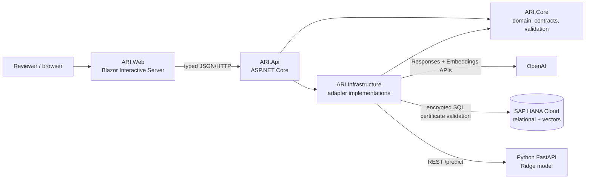
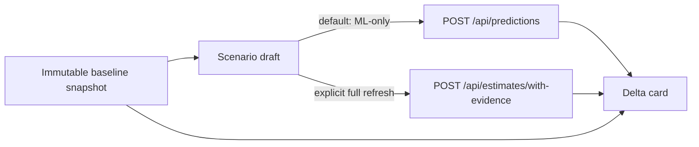
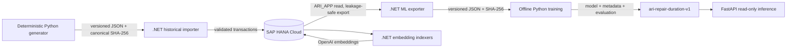

# ARI-RC1 architecture

## System context



The arrows distinguish runtime calls and code dependencies. `ARI.Core` has no reference to `ARI.Infrastructure`, SAP provider types, OpenAI transport types, or Python libraries. `ARI.Api` is the composition root. `ARI.Web` does not access HANA, OpenAI, or Python directly.

| Component | Owns | Must not own |
| --- | --- | --- |
| `ARI.Web` | forms, workflow state, 360° presentation, what-if comparison, typed API client | provider credentials, database access, prediction logic |
| `ARI.Api` | HTTP contracts, correlation IDs, orchestration, status mapping, dependency injection | vendor-specific domain rules or UI state |
| `ARI.Core` | domain facts, temporal validation, provider-neutral ports/contracts | SAP, OpenAI, FastAPI, or persistence implementations |
| `ARI.Infrastructure` | HANA SQL, vector retrieval, OpenAI adapters, Python ML adapter, failure translation | UI rendering or replacement domain policy |
| Python ML | offline training/evaluation and read-only Ridge inference | HANA credentials or request orchestration |
| SAP HANA Cloud | operational/history relations, dataset metadata, vector profiles | LLM generation or model training |
| OpenAI | schema-constrained text extraction, query/document embeddings, grounded wording | numerical labor prediction or source selection policy |

## Live analysis sequence

This sequence reflects the implemented `POST /api/estimates/with-evidence` orchestration. Prediction and retrieval currently run **sequentially**, not in parallel.

```mermaid
sequenceDiagram
    autonumber
    actor User as Browser user
    participant Web as ARI.Web
    participant Api as ARI.Api
    participant LLM as OpenAI extraction V3
    participant Validation as Core validation + deterministic classifier
    participant ML as Python FastAPI / Ridge
    participant HANA as SAP HANA Vector Engine
    participant Explain as OpenAI grounded explanation

    User->>Web: Submit pre-repair intake
    Web->>Api: POST /api/estimates/with-evidence
    Api->>LLM: Structured Outputs extraction
    LLM-->>Api: typed facts + evidence
    Api->>Validation: schema, evidence, quality, temporal checks
    Validation-->>Api: ACCEPTED / review / rejection
    alt accepted extraction
        Api->>ML: POST /predict with pre-repair features
        ML-->>Api: hours + model/data provenance
        Api->>HANA: RRF V2 retrieval with asOfUtc
        HANA-->>Api: ranked, source-addressed cases
        Api->>Explain: facts + prediction + retrieved sources
        Explain-->>Api: source-ID-constrained explanation
        Api-->>Web: extraction + prediction + sources + explanation + metadata
        Web-->>User: Repair Case 360°
    else not accepted
        Api-->>Web: controlled validation/review response
        Web-->>User: actionable status; no prediction
    end
```

The API validates every cited source identifier. An explanation-provider outage may return a visible partial result containing the already completed prediction and retrieval. Prediction or retrieval failure returns a controlled dependency failure instead of inventing a result.

## What-if sequence

The UI stores one immutable baseline snapshot. An ML-only scenario changes allowed pre-repair features and calls `POST /api/predictions`; it does not silently rerun retrieval or overwrite the baseline. A separately labelled full-evidence refresh can invoke the complete endpoint.



Scenario deltas measure model sensitivity under the current synthetic artifact; they are not causal estimates.

## Persistence and training flow



Python never receives HANA credentials. The .NET importer and exporter own HANA I/O. Training is not exposed as an API endpoint, and inference verifies the locally produced artifact checksum before loading it.

## Temporal and grounding boundaries

| Information | Prediction/search candidates | Later evidence/training label |
| --- | --- | --- |
| vehicle age and mileage at estimate time | yes | — |
| repair code and workshop baseline | yes | — |
| explicitly known pre-repair conditions | yes | — |
| actual labor | no | yes |
| completion report and complications | no | yes |
| future repairs after `asOfUtc` | no | no for that request |

V2 retrieval searches `PRE_REPAIR_PROFILE` vectors. `COMPLETION_EVIDENCE` is attached only after a candidate passes repair, classification, version, and time filters. The LLM receives only retrieved sources and cannot nominate its own database records.

## Operational endpoints

- `GET /health` — process liveness only.
- `GET /health/ready` — real TLS HANA authentication plus `SELECT CURRENT_USER FROM DUMMY`.
- `GET /health/ml/ready` — compatible checksum-verified model readiness.
- `POST /api/repair-reports/extract` — standalone structured extraction.
- `POST /api/predictions` — numerical Ridge boundary.
- `POST /api/repair-cases/search` — structured/semantic/hybrid/RRF retrieval.
- `POST /api/repair-cases/explain` — retrieval plus grounded explanation.
- `POST /api/estimates/with-evidence` — the end-to-end UI workflow.

See [API contracts](api-contract.md) for request/response semantics.

## Accepted decisions

The [ADR index](adr/README.md) consolidates the eight existing records. The most important ARI-RC1 choices are Core independence and a separate Python runtime (ADR 0001), leakage-safe model lifecycle (ADR 0005), HANA as vector store (ADR 0006), deterministic V3 classification (ADR 0007), and structured-first RRF V2 (ADR 0008).

